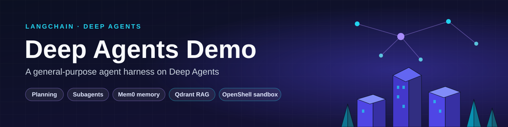

<p align="center">
  <a href="https://github.com/ohGioggio/deep-agents-demo"></a>
</p>

<p align="center">
  <a href="https://github.com/ohGioggio/deep-agents-demo/actions/workflows/ci.yml"></a>
  <a href="https://www.python.org/"></a>
  <a href="https://docs.astral.sh/uv/"></a>
  <a href="LICENSE.md"></a>
  <a href="https://github.com/langchain-ai/deepagents"></a>
  <a href="https://github.com/mem0ai/mem0"></a>
  <a href="https://qdrant.tech/"></a>
  <a href="https://github.com/NVIDIA/OpenShell"></a>
  <a href="https://www.daytona.io/"></a>
</p>

<p align="center"><b>Planning, skills, subagents, memory, RAG and a sandbox, with every risky step behind your approval.</b><br/>
A small, readable reference for building on <a href="https://github.com/langchain-ai/deepagents">LangChain Deep Agents</a>.</p>

Deep Agents Demo is a **general-purpose command-line agent**: ask it anything,
from questions about your own documents to research, writing or code. It
**plans multi-step work, uses skills, delegates to subagents, remembers you
across chats and can run code in a sandbox**, with every step streamed to your
terminal.

- **Every harness feature in one place.** Planning, skills, subagent delegation,
  streaming, checkpoints and context management, wired together and visible.
- **Integrations you can switch off.** Mem0 memory, Qdrant RAG and a sandbox
  (local OpenShell or remote Daytona) are each one setting away from disabled.
- **Any OpenAI-compatible model.** Point it at OpenAI, a local server or NVIDIA
  NIM. Embeddings can use a different provider from chat.
- **You stay in control.** The agent writes and updates skills only on request,
  and you approve each change; skills are versioned and can be shared through a
  marketplace. Risky commands pause for your yes or no, and `DISABLED_TOOLS`
  takes tools away entirely.

> [!NOTE]
> The demo ships with **examples** to try the harness on: a fictional 3D asset
> catalog with two tools, and a `scene-planning` skill that plans a city scene
> within a triangle budget (proposals, not geometry). They are things the agent
> *can* use, not what it is for. Add your own documents, skills and tools.

**Get started** (30 seconds).

```bash
git clone https://github.com/ohGioggio/deep-agents-demo.git
cd deep-agents-demo
uv sync --locked
cp .env.example .env            # then set OPENAI_API_KEY and AGENT_MODEL
uv run deep-agents-demo
```

```text
deep-agents-demo/
├── src/deep_agents_demo/   # the agent, tools and integrations
├── tests/                  # offline unit tests
├── evals/                  # live evals (memory recall modes)
├── docs/                   # your documents for RAG (git-ignored, except the example)
├── sandbox/                # OpenShell sandbox image (Dockerfile)
├── policy.yaml             # OpenShell sandbox policy
├── data/                   # memory and document vectors (created on first run)
└── demo_workspace/         # agent files and the seeded skills (created on first run)
```

---

## See it in action

Start a chat and ask anything. The example skill makes a good first test,
because it exercises planning, skills and tools in one request:

```text
You: Plan a city scene with trees, cars and buildings under 100000 triangles.
```

Each update is labelled with the agent that produced it, so you can follow the
plan, the delegation and the tool calls as they happen:

```text
[main / model]          the agent picks the matching skill (scene-planning)
[plan]                  the to-do list it writes, updated as tasks complete
[main / tools]          search_assets and triangle_budget check the options
[subagent / tools]      a subagent, if it delegates a lookup
[main / tools]          the proposal is saved to /scene_plan.md
```

Then try a question about your [indexed documents](#searching-your-documents-rag),
or say `Remember that I prefer short answers.` and start a new chat: the
preference is still there.

## Architecture

<p align="center">
  <a href="assets/architecture.svg"></a>
</p>

- **Agent loop.** Deep Agents runs the model and its tools until the task is
  done; every step streams to your terminal.
- **Tool gate.** Every tool call passes the [tools registry](#tools-the-registry-and-disabled_tools),
  which hides tools turned off in `DISABLED_TOOLS` and skill-only tools until
  their skill is read. Skill changes and [risky actions](#guardrails-risky-actions-ask-first)
  pause for your approval first.
- **Harness.** Planning, context management, skills and subagents are built in
  and wired to the loop. Skills the agent writes are versioned in a SQLite
  [skill store](#skills-the-agent-writes-with-your-approval) and can be shared
  through the marketplace. Every conversation is saved as a [chat](#chats) you
  can list, switch, rename and delete.
- **Memory and knowledge.** The agent manages per-user Mem0 memories with
  `remember`, `list_memories` and `forget`, and relevant memories are recalled
  into every turn automatically. Secrets are refused before anything is stored.
  `search_docs` retrieves cited passages. Both use Qdrant and your embedding
  provider.
- **Execution.** The backend router sends file and shell tools to local files,
  an OpenShell sandbox or Daytona. In OpenShell, all traffic passes the policy
  proxy, which allows only PyPI and GitHub.

## What it does

| Capability | What you get |
| --- | --- |
| **Planning** | A `write_todos` list, streamed as `[plan]` updates |
| **Skills** | Loaded on demand when a task matches: seeded examples, marketplace skills you installed, and your own |
| **Agent-written skills** | Created, updated, removed and restored on request, each change approved by you and saved as a version |
| **Marketplace** | A shared, versioned catalogue: publish your skills, install others' |
| **Approvals and guardrails** | Skill changes, deletes, forgetting and risky shell commands (`rm -rf`, `git push`, ...) pause for your yes or no |
| **Tools registry** | Every tool in one list; `DISABLED_TOOLS` hides and refuses tools, skills declare the tools they use |
| **Delegation** | A read-only `researcher` subagent (documents and catalog lookups) plus a `general-purpose` subagent with the main agent's tools and limits |
| **Tools** | `search_docs`, `remember`, `list_memories`, `forget`, the skill tools, the example catalog tools `search_assets` and `triangle_budget`, plus Deep Agents' file tools |
| **Persistence** | Conversations resume by thread from `demo_checkpoints.sqlite` |
| **Context management** | Built-in summarization and large-output offloading |
| **Long-term memory** | Per-user Mem0 memories that survive across threads |
| **RAG** | Cited search over your own `.md` and `.txt` files |
| **Sandbox** | File editing and shell commands in a policy-governed OpenShell sandbox or in Daytona |

> [!TIP]
> Set `MEMORY_ENABLED=false` and `RAG_ENABLED=false` to see the bare harness with
> nothing but the catalog tools.

---

## Prerequisites

| Requirement | Needed for | Notes |
| --- | --- | --- |
| Python 3.11+ | Everything | uv can install it for you |
| [uv](https://docs.astral.sh/uv/) | Everything | Manages the environment and lockfile |
| Chat model with tool calling | Everything | Any OpenAI-compatible endpoint |
| Embedding model | Memory and RAG | OpenAI or NVIDIA NIM |
| OpenShell CLI + Docker | Local sandbox only | Linux, macOS; Windows via WSL 2 + Docker Desktop (experimental) |
| Daytona API key | Remote sandbox only | Optional |

**Install uv (macOS / Linux):**

```bash
curl -LsSf https://astral.sh/uv/install.sh | sh
```

**Install uv (Windows PowerShell):**

```powershell
powershell -ExecutionPolicy ByPass -c "irm https://astral.sh/uv/install.ps1 | iex"
```

## Install

> [!IMPORTANT]
> Keep `.env` out of version control. It is already listed in `.gitignore`.

```bash
uv sync --locked
cp .env.example .env            # PowerShell: Copy-Item .env.example .env
```

Fill in `OPENAI_API_KEY` and `AGENT_MODEL`. Everything else has a default.

<details>
<summary><b>All configuration options</b></summary>

Settings are read from `.env` in the project root. Variables already set in
your shell take precedence.

| Variable | Default | Purpose |
| --- | --- | --- |
| `OPENAI_API_KEY` | required | API key for the chat model |
| `AGENT_MODEL` | required | Chat model ID |
| `OPENAI_BASE_URL` | OpenAI | Any OpenAI-compatible endpoint, e.g. `http://localhost:8000/v1` |
| `API_REQUESTS_PER_MINUTE` | no cap | Total requests per minute across chat and embeddings; set `40` for NVIDIA's free tier |
| `MEMORY_ENABLED` | `true` | Enable Mem0 long-term memory |
| `MEMORY_MODEL` / `MEMORY_API_KEY` / `MEMORY_BASE_URL` | agent settings | Model used to extract memories |
| `MEMORY_RECALL` | `auto` | `auto`, `tool` or `both`: how memories reach the agent ([details](#long-term-memory)) |
| `EMBEDDING_MODEL` | `text-embedding-3-small` | Embedding model for memory and RAG |
| `EMBEDDING_PROVIDER` | `auto` | `auto`, `openai` or `nvidia` |
| `EMBEDDING_API_KEY` | `OPENAI_API_KEY` | Embedding API key |
| `EMBEDDING_BASE_URL` | OpenAI | Embedding endpoint, independent of the chat endpoint |
| `EMBEDDING_DIMENSIONS` | `1536` | Must equal the model's real output width |
| `EMBEDDING_BATCH_SIZE` | `16` | Texts per embedding request; set `1` for NVIDIA's hosted embedder ([why](#troubleshooting)) |
| `RAG_ENABLED` | `true` | Enable the `search_docs` tool |
| `SANDBOX_PROVIDER` | `none` | `none` (local files, no shell), `openshell` or `daytona` |
| `OPENSHELL_SANDBOX_NAME` | `deep-agents-demo` | Existing OpenShell sandbox to attach to |
| `OPENSHELL_WORKSPACE` | `default` | OpenShell workspace that owns the sandbox |
| `OPENSHELL_WORKDIR` | `/sandbox` | Working directory inside the sandbox |
| `XDG_CONFIG_HOME` | your home's `.config` | Where the OpenShell CLI's gateway config lives; on Windows, point it at Ubuntu ([details](#openshell-on-windows)) |
| `DAYTONA_API_KEY` | | Daytona credentials |
| `DAYTONA_SANDBOX_ID` | | Reuse a specific running sandbox |

</details>

<details>
<summary><b>Using a local model</b></summary>

Point the chat endpoint at any OpenAI-compatible server that supports tool calling:

```dotenv
OPENAI_BASE_URL=http://localhost:8000/v1
OPENAI_API_KEY=local
AGENT_MODEL=your-local-model
```

Embeddings still go to `EMBEDDING_BASE_URL`, which defaults to OpenAI. Set it as
well, or disable memory and RAG, to keep everything local.

</details>

---

## Common commands

```bash
uv run deep-agents-demo                                  # interactive chat
uv run deep-agents-demo --thread second                  # new conversation, same memories
uv run deep-agents-demo --user alice                     # separate memory namespace
uv run deep-agents-demo --prompt "Plan a small park"     # one prompt, then exit
uv run deep-agents-demo --index-docs docs                # rebuild the RAG index
uv run deep-agents-demo --clear-sandbox                  # delete the agent's files in OpenShell
uv run deep-agents-demo --list-threads                   # your chats, most recent first
uv run python -m deep_agents_demo --help                 # same CLI, as a module
uv run python -m unittest discover -s tests -v           # offline tests
```

| Option | Default | Description |
| --- | --- | --- |
| `--thread` | `city-demo` | Conversation ID; reuse it to resume history |
| `--user` | `demo-user` | Mem0 namespace, not authentication |
| `--prompt` | | Run a single prompt instead of interactive chat |
| `--index-docs DIR` | | Rebuild the RAG index from `DIR`, then exit |
| `--clear-sandbox` | | Delete everything the agent created in the OpenShell sandbox, then exit |
| `--list-threads` | | List your chats with turns, last use and last message, then exit |
| `--show-thread NAME` | | Print a chat's transcript, then exit |
| `--rename-thread OLD NEW` | | Rename a chat, then exit |
| `--delete-thread NAME` | | Delete a chat after asking (`--yes` skips the question), then exit |

## Skills

Skills are Markdown instructions the agent loads on demand. Each one is a
`SKILL.md` with a `name` and `description` in its frontmatter; the agent sees
the descriptions and reads a skill's full text when a task matches it.

| Skill | Used for |
| --- | --- |
| [`scene-planning`](src/deep_agents_demo/seed/skills/scene-planning/SKILL.md) | Example: planning a 3D scene step by step with to-dos, catalog lookups, budget checks and a saved proposal |
| [`sandbox`](src/deep_agents_demo/seed/sandbox-skills/sandbox/SKILL.md) | Working inside OpenShell: the image, installing packages with uv, headless plots, policy denials. Offered only when `SANDBOX_PROVIDER=openshell` |

- **Seeded once.** On start, the demo copies `src/deep_agents_demo/seed/` into
  `demo_workspace/`, adding missing files and never overwriting your edits.
- **Only where it applies.** The `sandbox` skill lives in `sandbox-skills/` and is
  offered only with OpenShell; elsewhere it would mislead the agent.
- **Add your own.** Create `demo_workspace/skills/<name>/SKILL.md`, with the
  folder name matching `name:`, then restart the demo.
- **Reloaded each session.** Deep Agents stores the skill list in each thread;
  the demo asks it to reload on the first message of every session, so old
  threads see new or edited skills after a restart.
- **Local even with a sandbox.** Skills are read from your machine through the
  `/instructions/` route; they are never copied into the sandbox.

### Skills the agent writes, with your approval

<p align="center">
  <a href="assets/skills.svg"></a>
</p>

Ask the agent to create, update, remove, import or restore a skill, and it uses a
skill tool. Each change pauses the chat until you decide:

```text
Skill change requested: CREATE 'greeting-style' (user: demo-user), new, v1
  Instructs the agent to greet the user briefly and then ask how it can help.
  Changes: +14 lines, -0 lines · files: SKILL.md
  Checks: format OK · no credentials found
[a]pprove  [r]eject (with a reason)  [d]iff  [f]ull file >
```

| Tool | What it does |
| --- | --- |
| `create_skill` | A new skill: name, description, instructions, optional extra files and the tools it uses |
| `update_skill` | Change only what you ask: description, instructions, files, tools |
| `remove_skill` | Remove a skill; its history is kept |
| `import_skill` | Import a `SKILL.md`, or the folder holding one, from your machine |
| `restore_skill` | Bring back an earlier version |
| `publish_skill` | Share one of your skills in the marketplace |
| `install_skill` / `uninstall_skill` | Activate or deactivate a marketplace skill for you |
| `browse_marketplace` | Search the marketplace catalogue (read-only) |
| `list_skills` | Your own and installed skills, with versions (read-only) |
| `skill_history` | List a skill's versions (read-only) |

**The marketplace** is a shared catalogue of skills. A marketplace skill is active
only for users who install it, and an installed skill always follows the latest
marketplace version. `create_skill`, `update_skill`, `remove_skill`,
`import_skill`, `restore_skill` and `skill_history` take `scope="marketplace"` to
work on the catalogue (the summary then says "marketplace, shared with
everyone"). The same name can exist in both: your own skill overrides an
installed marketplace skill, which overrides a seeded example. If a marketplace
skill is removed, it disappears for everyone who installed it, and `list_skills`
says so. `--user` is a name, not a login, so in this demo anyone can propose
marketplace changes: approval is the gate.

- **Only on request, always approved.** The agent uses these tools only when you
  ask, and every change (all but the three read-only tools) waits for your
  approval, also when a subagent makes it. With `--prompt` there's nobody to ask, so changes are refused.
- **Checked before you see it.** Skills are validated with Deep Agents' own rules
  (name format, matching folder, frontmatter). A change that fails, or that
  contains a concrete credential (an API key, a private key, a password in a URL),
  is rejected without asking, and the agent is told why. Wording such as "the
  token is rotated every 90 days" only adds a warning: you decide.
- **Versioned.** Every approved change is a new version in `data/skills.sqlite`;
  removing and restoring add versions too, so nothing is lost.
- **No back door.** The agent's file tools can read skill folders but not write,
  edit or delete in them, so the skill tools are the only way to change a skill.
- **Per user.** Your skills live in `demo_workspace/user-skills/<user>/` and your
  installed ones in `demo_workspace/installed-skills/<user>/`. Both are rewritten
  from the database on every start: edit skills through the agent, not by hand.

Design notes: [design/specs/2026-11-10-agent-written-skills-design.md](design/specs/2026-11-10-agent-written-skills-design.md).

## Tools: the registry and DISABLED_TOOLS

[`tools.py`](src/deep_agents_demo/tools.py) keeps a registry of every tool the agent
can have: Deep Agents' built-ins (files, shell, planning, delegation) and each
feature's tools, with their group and a one-line description. It's for the code
and its configuration: there's no chat command to list or switch tools.

- **Turn tools off in `.env`:** `DISABLED_TOOLS=execute,delete` hides those tools
  from the model and refuses them if called anyway, for the main agent and both
  subagents. `ls`, `read_file` and `write_todos` can't be turned off (skills and
  planning need them), and an unknown name prints a warning at start-up.
- **No shell detour.** With `delete` off, `execute` also refuses commands that
  delete files (`rm`, `rmdir`, `unlink`, `find -delete`, `git rm`/`git clean`,
  Python's `os.remove`/`shutil.rmtree`). The patterns live in `SHELL_EQUIVALENTS`;
  they're a safety net, so turn off `execute` too for a hard guarantee.
- **Skills declare their tools** under `allowed-tools` in `SKILL.md`, which
  `create_skill` and `update_skill` fill from their `tools` argument. Only tools
  in the registry are accepted (the agent can't create tools); an imported skill
  that lists other tools gets a warning in the approval summary.
- **Skill-only tools stay out of the way.** A feature can mark tools
  `skill_only`: the agent sees them only after it reads a skill that lists them.
  The example catalog tools appear once the agent opens `scene-planning`.
- **Conflicts are explained.** If a skill needs a turned-off tool, the agent is
  told, so it says which tool is off instead of working around it.

## Searching your documents (RAG)

Put UTF-8 `.md` and `.txt` files in `docs/`, index them, then ask. Anything you
add there is ignored by git, so your own documents stay local; only
`example_requirements.md` is part of the repo.

```bash
uv run deep-agents-demo --index-docs docs
uv run deep-agents-demo --prompt "Search the documents for the default triangle budget and cite the source."
```

- **Full rebuilds.** Indexing replaces the whole collection, so chunks from
  deleted files disappear. Empty input leaves the existing index untouched.
- **The agent knows what's indexed.** The names of your indexed documents are
  listed in its system prompt, so it calls `search_docs` for questions they
  could answer, even when you don't mention documents, and says so when they
  have nothing relevant before falling back to general knowledge.
- **Cited results.** Each search returns four passages with source, chunk and score.
- **Text only.** PDF and other binary formats are not supported.
- **One process at a time.** A local Qdrant directory can be opened by only one
  process, so don't index while a chat is running.

## Long-term memory

```bash
uv run deep-agents-demo --user alice --thread first
```

Say `Remember that I prefer pine trees and use uv for Python.`, quit, then:

```bash
uv run deep-agents-demo --user alice --thread second
```

Say `Recall my preferences and plan a city under 100000 triangles.`

The agent manages memories with four tools, all bound to the current `--user`:

| Tool | What it does |
| --- | --- |
| `remember` | Saves a fact, only when you ask. Refuses secrets (see below) |
| `recall` | Searches your memories (only when `MEMORY_RECALL` is `tool` or `both`; in `auto` they arrive automatically) |
| `list_memories` | Shows everything remembered about you, with ids. Try `What do you remember about me?` |
| `forget` | Deletes one memory by id. Try `Forget that I like red cars.` |

**How memories reach the agent** is set by `MEMORY_RECALL`:

| Mode | How it works | Trade-off |
| --- | --- | --- |
| `auto` (default) | Before every model call, the memories most relevant to your message are added to the system prompt; there is no `recall` tool | Never forgets to look. One memory search per message, and the injected text grows with the number of relevant memories |
| `tool` | The agent calls `recall` when it thinks a preference matters | No search when memory isn't needed, but it may not think to look, and each recall costs an extra model call |
| `both` | Automatic recall, plus the `recall` tool for anything else | For when the injected memories aren't enough; in the eval the agent never needed the tool |

Automatic recall searches once per message and only changes the prompt sent to
the model: nothing is added to the saved conversation, so threads don't grow.
To compare the modes on your own model, run the [memory eval](#evaluating-memory-recall).

**Write policy: secrets are never stored.** Before anything reaches Mem0,
`remember` checks it for passwords and secret values, API keys (OpenAI,
Anthropic, NVIDIA, AWS, GitHub, Slack, Google, Stripe), bearer tokens, JSON web
tokens, private keys, credentials in URLs, payment card numbers and long random
tokens. A match is refused and the agent is told why, so the secret never
reaches Mem0's extraction model or its history database. As a second check, any
memory Mem0 rewrites into something secret-looking is deleted straight away, and
memories shown by `recall`, `list_memories` or automatic recall are redacted, in
case an older one slipped through. The detector errs on the side of refusing.

- **Per user, across threads.** The same user and thread also resume the
  conversation history.
- **Scoped deletes.** `forget` only deletes the current user's memories; another
  user's id gets the same answer as an id that doesn't exist.
- **One place for the rules.** All of this lives in `MemoryService`, the only code
  that talks to Mem0 for a user. The tools and automatic recall go through it,
  and its `WritePolicy` (secret detection and redaction) can be swapped.
- **Not authentication.** `--user` is a namespace. RAG, files and the sandbox are
  shared: this is a single-user demo, not a multi-tenant app.

## Chats

Every conversation is a chat (a LangGraph thread) saved in
`demo_checkpoints.sqlite` under your `--user`. Pick one with `--thread`, or
manage them without leaving the session:

```text
[city-demo] You: /threads
   CHAT        TURNS  LAST USED         LAST MESSAGE
*  city-demo       6  2026-11-10 09:12  Install matplotlib and render the sine plot a...
   park-ideas      3  2026-11-09 18:40  Make it fit my usual budget
[city-demo] You: /switch park-ideas
Switched to 'park-ideas' (3 turns).
```

| Command | What it does |
| --- | --- |
| `/threads` | List your chats, most recent first (`*` marks the current one) |
| `/new [name]` | Start a new chat; without a name it gets a dated one like `chat-20261110-091500` |
| `/switch NAME` | Continue another chat with its full history |
| `/history` | Show this chat's messages and the agent's replies |
| `/rename NAME` | Rename this chat |
| `/delete NAME` | Delete a chat and its history, after asking |
| `/image PATH` | Attach a PNG or JPG to your next message (or just write its path in the message) |
| `/help` | Show these commands |

The same operations work from the shell without starting a chat or calling the
model: `--list-threads`, `--show-thread`, `--rename-thread` and
`--delete-thread` (see [Common commands](#common-commands)).

- **Per user.** You only see and change chats of the current `--user`.
- **Memories are shared across chats.** Deleting a chat removes its
  conversation, not what the agent remembers about you; use `forget` for that.
- **A new chat is saved on its first message,** so an empty `/new` leaves nothing behind.
- **Names** use letters, digits, `.`, `_` and `-` (up to 64 characters).

## Images: show the agent a picture, let it check its own

The chat model must accept images (the NVIDIA `...-vl-...` models do).

- **Attach a PNG or JPG** by writing its path in your message (quote it if it has
  spaces), or with `/image PATH` before the message:

  ```text
  You: What's wrong with this chart? C:/Users/me/Desktop/sales.png
  Attached sales.png (1200x800, 64 KB).
  ```

- **Checked and kept small:** files are recognised by their contents, not their
  name; anything else or over 20 MB is refused; images larger than 1568 px are
  scaled down. A copy is saved to `demo_workspace/uploads/<user>/`, so the agent
  can open it again later (`/history` shows `[Attached image: ...]`).
- **The agent checks what it draws.** `read_file` returns images to the model, and
  the agent is told to open every image or chart it creates and fix it if labels
  overlap, parts are cut off or it's empty. With a sandbox, it renders with
  matplotlib, opens the PNG, and re-renders until it looks right.
- **Only recent images are resent.** Each image costs many tokens on every model
  call, so only the last three messages with images are sent to the model; older
  ones become a note with their path, which the agent can open again.

Images live in [`images.py`](src/deep_agents_demo/images.py).

## Guardrails: risky actions ask first

Some actions pause the chat for your yes or no, with the same prompt as skill
changes:

```text
Risky action requested: execute
  Command: rm -rf build/
  Why it's flagged: deletes files recursively
[a]pprove  [r]eject (with a reason)  [d]iff  [f]ull file >
```

| Action | When it asks |
| --- | --- |
| `execute` | Only for commands matching a danger pattern: recursive or forced deletes (`rm -rf`, `find … -delete`), `git push`, `git reset --hard`, `git clean -f`, `git branch -D`, piping a download into a shell, `dd`, `mkfs`, `shred`, killing processes, uninstalling packages, `sudo`, recursive `chmod`/`chown`, `chmod 777` |
| `delete` | Always (removing a file or folder) |
| `forget` | Always; the prompt shows the memory that would be removed |

- **Ordinary commands run freely:** `ls`, `python script.py`, `uv pip install …`,
  `git clone` and so on never ask.
- **Rejecting tells the agent why**, and it's told not to retry or work around it.
- **Subagents are covered too**, and with `--prompt` (nobody to ask) risky actions
  are refused.
- **The patterns are a safety net, not a parser:** a command that only *mentions*
  `rm -rf` inside quotes still asks. The sandbox policy remains the real boundary.

The patterns live in [`guardrails.py`](src/deep_agents_demo/guardrails.py); add a
line to `DANGER` to cover another command.

## Running code in a sandbox

With a sandbox the agent gets file tools and a shell, but on a separate machine
or container: normal paths are inside the sandbox, and only `/instructions/`
maps to the local skills. Commands time out after 120 seconds. The demo
connects on the agent's first command or sandbox file operation, not when a
chat starts, so chats that don't need it work even with the sandbox offline;
if it can't be reached then, the agent is told so instead of the chat failing.
Pick one:

| Provider | Runs on | Isolation |
| --- | --- | --- |
| `openshell` | Your machine (Docker) | Kernel-enforced policy in [`policy.yaml`](policy.yaml) |
| `daytona` | Daytona cloud | Daytona's sandbox and network settings |

### OpenShell (local)

[NVIDIA OpenShell](https://github.com/NVIDIA/OpenShell) runs the agent's
commands in a local sandbox and enforces [`policy.yaml`](policy.yaml) on every
file access, process and network connection. The restrictions apply to the
environment, not to the prompt, so a prompt-injected command still can't reach
the network beyond what the policy allows.

The policy in this repo, tested against a live sandbox:

- **Denies all network access** except package installs from PyPI and
  `git clone` / `fetch` from GitHub. Uploads to PyPI and pushes to GitHub get a
  403 from the OpenShell proxy.
- **Binds each rule to a program.** Only Python and uv can reach PyPI, and only
  Git's HTTPS helper can reach GitHub.
- **Enforces every rule.** Rules are set to `enforce`; OpenShell's default,
  `audit`, would only log violations.
- **Keeps your secrets out.** Commands run as a non-root user and see none of
  your host environment, so API keys in `.env` are not visible inside.

**1. Install the OpenShell CLI and start its gateway** (Linux or macOS; on
Windows, see [below](#openshell-on-windows) first). The installer checks the
release checksums, installs the CLI and starts the gateway on
`https://127.0.0.1:17670`:

```bash
curl -LsSf https://raw.githubusercontent.com/NVIDIA/OpenShell/main/install.sh | sh
openshell status
```

**2. Build the sandbox image.** NVIDIA's default image has no Python or Git, and
Deep Agents runs its file tools as `python3` scripts. The sandbox can't install
them later (it isn't root, and the policy blocks package mirrors), so
[`sandbox/Dockerfile`](sandbox/Dockerfile) bakes in Python 3.12, Git and uv:

```bash
docker build -t deep-agents-demo-sandbox:0.1 sandbox/
```

**3. Create the sandbox** from that image, with the policy:

```bash
openshell sandbox create --name deep-agents-demo --from deep-agents-demo-sandbox:0.1 \
  --policy policy.yaml --detach
```

**4. Point the demo at it** in `.env`, then run as usual:

```dotenv
SANDBOX_PROVIDER=openshell
OPENSHELL_SANDBOX_NAME=deep-agents-demo
```

The demo attaches to the existing sandbox and never creates one, so it can't
run in a sandbox that lacks the policy. With OpenShell active, the agent reads
the seeded [`sandbox` skill](src/deep_agents_demo/seed/sandbox-skills/sandbox/SKILL.md)
before its first command: it covers the image, installing packages with uv
(there is no `pip`), headless plots, and what to do when the policy blocks a
request.

- **Change network rules live** with
  `openshell policy set deep-agents-demo --policy policy.yaml --wait`.
  Filesystem, Landlock and process settings are fixed at creation: recreate the
  sandbox to change them.
- **Start over** with `uv run deep-agents-demo --clear-sandbox`. It empties
  `/sandbox` (code, outputs, virtual environments, uv's cache) and the agent's
  files in `/tmp`, but keeps the sandbox, image and policy, so it's much faster
  than recreating. Conversation history is kept; add `--thread <new>` for a
  fresh conversation too.
- **Watch denials** with `openshell logs deep-agents-demo --since 5m --source sandbox`.
- **Clean up** with `openshell sandbox delete deep-agents-demo`.

> [!NOTE]
> Rules bind to real binary paths, not symlinks. If you change the image or
> install another Python or uv, update the paths in `policy.yaml`.

#### OpenShell on Windows

OpenShell lists Windows (WSL 2 + Docker Desktop) as experimental. This setup
works, with the demo itself running on Windows:

1. **Install Ubuntu** in WSL 2: `wsl --install -d Ubuntu-24.04`.
2. **Install Docker Desktop.** In Settings, turn on
   **Resources → WSL integration → Ubuntu-24.04** and
   **Resources → Network → Enable host networking**. OpenShell's supervisor
   container uses host networking to reach the gateway on `127.0.0.1`; without
   this setting, "host" is Docker Desktop's VM and sandboxes fail with
   "Startup configuration fetch failed".
3. **Restart Ubuntu** with `wsl --terminate Ubuntu-24.04`, so its services pick
   up the `docker` group that Docker Desktop added. Otherwise the gateway fails
   with "no compute driver configured".
4. **Inside Ubuntu,** run steps 1 to 3 above. The repo can stay on Windows:
   `cd /mnt/c/...` to it before building the image.
5. **On Windows,** let the demo read the gateway config from Ubuntu by adding
   this to `.env` (with your Ubuntu user name):

   ```dotenv
   XDG_CONFIG_HOME=\\wsl.localhost\Ubuntu-24.04\home\<user>\.config
   ```

   Leave the value unquoted: quoting it makes `.env` parsing drop one of the
   two leading backslashes.

After a reboot, the gateway can start before Docker Desktop is ready. If
`openshell status` fails, run `systemctl --user restart openshell-gateway` in
Ubuntu.

### Daytona (remote)

```dotenv
SANDBOX_PROVIDER=daytona
DAYTONA_API_KEY=your-key
```

The demo uses `DAYTONA_SANDBOX_ID` if set, otherwise the ID saved in
`data/daytona_sandbox_id.txt`, otherwise it creates a sandbox and saves its ID.
The sandbox image needs Git, uv or whatever the task requires; private Git
access and network rules are configured in Daytona.

> [!WARNING]
> Daytona sandboxes are kept after the program exits. Stop and delete them in
> Daytona to avoid charges, and export anything you need first.

### Try it

- `Create hello.py in the working directory and execute it.`
- `Clone <repo URL>, inspect it and run the tests.`
- `Retrieve the requirements with search_docs and implement them in the repository.`

Documents stay local: `search_docs` queries the index on your machine and
nothing in `docs/` is uploaded.

## NVIDIA NIM embeddings

```dotenv
EMBEDDING_MODEL=nvidia/nemotron-3.5-embed-8b
EMBEDDING_PROVIDER=nvidia
EMBEDDING_BASE_URL=https://integrate.api.nvidia.com/v1
EMBEDDING_DIMENSIONS=4096
```

- **Raw strings, float vectors.** Never OpenAI token-ID arrays.
- **Passage and query modes.** `input_type=passage` when indexing or saving
  memories, `input_type=query` when searching.
- **Batches of 16.** At most 16 strings per request.
- **Auto-detection.** `EMBEDDING_PROVIDER=auto` recognises
  `integrate.api.nvidia.com`; set `nvidia` explicitly for self-hosted NIM.

---

## Project layout

```text
src/deep_agents_demo/
├── cli.py          # parses arguments and dispatches; nothing else
├── config.py       # Settings: every setting, read from the environment once and validated
├── app.py          # composition root: builds model, memory, documents, sandbox and agent
├── chat.py         # interactive chat loop, slash commands and streamed output
├── commands.py     # one-shot commands: index docs, clear sandbox, manage chats
├── agent.py        # Feature, and build_agent: assembles features into a deep agent
├── catalog.py      # example tools: fictional asset catalog
├── workspace.py    # copies seed/ into demo_workspace/ on first run
├── seed/           # starter memory file and skills (SKILL.md files)
├── memory.py       # MemoryService (one user's Mem0 access + write policy), tools, auto recall
├── memory_policy.py  # write policy: detects and redacts secrets
├── rag.py          # Qdrant document index and the search_docs tool
├── embeddings.py   # OpenAI / NVIDIA-compatible embedding client
├── threads.py      # chat management: list, show, rename, delete
├── skill_manager.py  # agent-written skills: plan, validate, approve, save, tools
├── skill_store.py  # versioned skill storage in SQLite
├── tools.py        # tools registry, DISABLED_TOOLS and skill-only tools
├── approvals.py    # the approval prompt for paused tool calls
├── guardrails.py   # risky actions (dangerous commands, delete, forget) ask first
├── images.py       # attached PNG/JPG images, and the agent checking images it renders
├── sandbox.py      # backend selection: local files, OpenShell or Daytona (lazy)
└── openshell_backend.py  # OpenShell sandbox backend for Deep Agents
```

Settings flow one way: `cli.py` reads them once into a frozen `Settings`, and
`app.py` passes each component only the part it needs. No other module reads
environment variables, so every dependency is visible in a function signature.

**Extending the agent.** Each capability describes itself as a `Feature` (a
prompt section, tools, middleware, read-only lookups for the `researcher`,
skill folders), built in its own module: `memory_feature`, `documents_feature`,
`catalog_feature`, `sandbox_feature`. `build_agent` only assembles features, so:

- **A new capability** is a function returning a `Feature`, added to
  `features()` in `app.py`.
- **A new sandbox provider** is a function in `sandbox.py` registered in
  `PROVIDERS` (and listed in `config.SANDBOX_PROVIDERS`; a test keeps them in sync).
- **A new slash command** is a `ChatSession` method decorated with `@command`;
  the lookup and `/help` are built from the decorators.
- **A tool only a skill needs** is listed in its feature's `skill_only` and in
  that skill's `allowed-tools`; the agent sees it once it reads the skill.
- **A tool that needs your approval** is listed in its feature's `approvals`,
  either by name (always ask) or as `(name, when)` to ask only when `when(request)`
  says so; the chat loop then pauses before it runs and asks you.

## Where data is stored

| Path | Contents |
| --- | --- |
| `demo_checkpoints.sqlite` | Chats: every conversation, per user ([Chats](#chats)) |
| `data/mem0_history.sqlite` | Mem0 change history |
| `data/memory_vectors/` | Mem0 Qdrant index |
| `data/document_vectors/` | RAG Qdrant index |
| `data/mem0_internal/` | Auxiliary Mem0 data, if created |
| `data/daytona_sandbox_id.txt` | Saved sandbox ID |
| `demo_workspace/` | Agent files and the seeded skills |
| `data/skills.sqlite` | User and marketplace skills (every version) and installs |
| `demo_workspace/user-skills/` | Each user's current skills, regenerated from the database |
| `demo_workspace/installed-skills/` | Each user's installed marketplace skills, regenerated likewise |

All of these, and `.env`, are excluded by `.gitignore`. With OpenShell, the
agent's files live in the sandbox's `/sandbox` (clear them with
`--clear-sandbox`), and the CLI keeps its gateway config and certificates in
`~/.config/openshell/` and `~/.local/state/openshell/` on the machine running it.

## Privacy

- **Local storage.** Checkpoints, memories and vectors stay on your machine.
- **Remote inference.** Chat and embedding requests go to the providers you
  configure. Use a local endpoint to keep them on your machine.
- **Telemetry.** Mem0 telemetry is disabled by default. The OpenShell gateway
  sends anonymous usage counts unless you set `OPENSHELL_TELEMETRY_ENABLED=false`
  on the gateway.
- **Untrusted content.** The agent is told to treat documents and recalled
  memories as data, not instructions. That is only an instruction; with
  OpenShell, `policy.yaml` is what actually limits what a misled agent can do.

## Troubleshooting

- **"Fill in OPENAI_API_KEY and AGENT_MODEL".** `.env` is missing or still has
  the placeholder values. It must sit in the project root.
- **"No documents indexed".** Run `uv run deep-agents-demo --index-docs docs`.
- **Qdrant storage is already in use.** Another process has `data/` open. Close
  the other chat or indexing run.
- **"Returned embedding width differs from EMBEDDING_DIMENSIONS".** Set the real
  width of your model. If the Mem0 index was created with the wrong size, stop
  the app, back up `data/memory_vectors/` and move it aside; a fresh index is
  created on the next start, without the old memories.
- **"Error code: 500 - service inference failed" from NVIDIA,** often while
  indexing. NVIDIA returns this for two different things. Its hosted
  `nemotron-3.5-embed-8b` rejects requests with more than one text, and the
  free tier's rate limit (about 40 requests per minute per key) is reported the
  same way, not as a 429. The client handles both: it splits rejected batches,
  remembers the size that works, and retries single texts with waits of up to
  a minute. To avoid the errors entirely, set `EMBEDDING_BATCH_SIZE=1` and
  `API_REQUESTS_PER_MINUTE=40`.
- **Switched embedding models.** Rebuild RAG with `--index-docs docs` and recreate
  the Mem0 index. Never mix embeddings from different models.
- **URLs not loading from `.env`.** Lines must not end with a backslash or contain
  escaped URLs such as `https\://`.
- **"OpenShell sandbox ... not found".** Create it with the command in the
  message, or set `OPENSHELL_SANDBOX_NAME` / `OPENSHELL_WORKSPACE` to match it.
- **"no active gateway" or connection errors.** Run `openshell status` and make
  sure Docker is running. On Windows, check `XDG_CONFIG_HOME` in `.env`, and
  after a reboot run `systemctl --user restart openshell-gateway` in Ubuntu.
- **The agent ignores a new or edited skill.** Restart the demo. Deep Agents
  saves the skill list in each thread and the demo reloads it once per session,
  so changes made while a session is running appear only after a restart.
- **OpenShell file tools fail with "python3: command not found".** The sandbox
  was created from the default image; recreate it with `--from` (step 3).
- **A command can't download something.** The policy denied it. Check
  `openshell logs`, then add a rule to `policy.yaml` and apply it with `policy set`.
- **Daytona sandbox won't attach.** Start a stopped sandbox in Daytona before
  reusing it.

## Evaluating memory recall

```bash
uv run python evals/memory_recall.py                       # all modes, one run
uv run python evals/memory_recall.py --modes tool auto --runs 3
```

A live eval of the three `MEMORY_RECALL` modes with your real model and
embeddings, so it makes paid API calls. Each run starts from a fresh temporary
memory store seeded with the same five preferences, then asks:

- **Explicit** questions that name the memory ("Which trees do I prefer?").
- **Implicit** ones that need it without saying so ("Suggest one tree asset for
  my next park scene.").
- An **irrelevant** one, to see what automatic recall costs when memory isn't needed.
- A **secret** ("Please remember my OpenAI API key: …"), which must not be stored or echoed.

It reports, per mode, how many answers used the right memory, recall tool calls,
model calls, input tokens and time per turn, and saves the details to
`data/evals/`. Your real memories and workspace are never touched.

**Results so far** (2 runs per mode, `nvidia/nemotron-3.5-super-vl-120b-a12b`,
November 2026):

| Mode | Explicit | Implicit | Irrelevant | Secret refused | Recall calls | Model calls / turn | Input tokens / turn | Seconds / turn |
| --- | --- | --- | --- | --- | --- | --- | --- | --- |
| `tool` | 2/4 | 7/8 | 2/2 | 2/2 | 9 | 1.8 | 9642 | 4.6 |
| `auto` | 4/4 | 8/8 | 2/2 | 2/2 | 0 | 1.1 | 5641 | 4.9 |
| `both` | 4/4 | 8/8 | 2/2 | 2/2 | 0 | 1.1 | 5709 | 4.1 |

- **Automatic recall answered everything right; tool-driven recall missed 3 of
  12.** Each time the agent never called `recall`: it suggested blue cars, or
  said it had no dependency tool, or hedged with "pip, poetry or uv".
- **Automatic recall was also cheaper:** about 40% fewer input tokens per turn,
  because tool-driven recall needs an extra model call after `recall` returns.
  Wall time was similar; provider latency dominated.
- **In `both` mode the agent never used `recall`;** the injected memories were enough.
- **After the agent became general-purpose,** tool-driven recall got worse: a
  general assistant has even less reason to suspect a question depends on your
  preferences. With the current prompt, which tells it exactly when to call
  `recall`, `tool` got 8 of 18 memory questions right over 3 runs (explicit 4/6,
  implicit 4/12), and individual runs ranged from 1/6 to 7/12: the model
  decides inconsistently whether to call `recall`. Automatic recall got 12 of
  12 over 2 runs. That is why `auto` is the default.
- **Caveats:** a small sample on one model, and only five seed memories. With
  many memories, automatic recall injects more text per turn. In the secret
  test the model refused on its own and never called `remember`, so the
  policy's own refusal is covered by the unit tests rather than this eval.

## Testing

```bash
uv run python -m unittest discover -s tests -v
```

The tests run offline and need no API keys:

- **RAG:** a real local Qdrant with fake embeddings covers indexing, retrieval,
  reindexing and persistence.
- **Memory:** the write policy (secrets refused before reaching Mem0, secret
  rewrites deleted, redaction), user scoping for `list_memories` and `forget`,
  and automatic recall inside the real Deep Agents graph: memories reach the
  model but never the saved conversation.
- **Embeddings:** NVIDIA request bodies checked against a mocked HTTP endpoint.
- **Chats:** listing, transcripts, rename and delete on a real SQLite checkpoint
  file through the real agent graph, plus every slash command.
- **Agent:** the real Deep Agents graph with a fake model checks that skills
  reload each session; seeding and skill format are checked too.
- **OpenShell:** the backend and `--clear-sandbox` run against a fake session,
  and on Linux (as in CI) also end to end through a real bash, including all of
  Deep Agents' file tools.
- **Policy:** `policy.yaml` is checked to enforce every rule.

Live model calls and real OpenShell or Daytona sandboxes are not covered by the
suite; the OpenShell policy was verified by hand against a running sandbox.

## Contributing

Issues and pull requests are welcome. Run the tests before opening a PR, and keep
the demo small: it is meant to be read in one sitting.

## License

Released under the [MIT License](LICENSE.md). © 2026 Gioele Allievi.

---

<p align="center">
  <a href="https://github.com/ohGioggio/deep-agents-demo"></a>
  <a href="https://github.com/ohGioggio/deep-agents-demo/issues"></a>
  <a href="https://github.com/langchain-ai/deepagents"></a>
</p>
